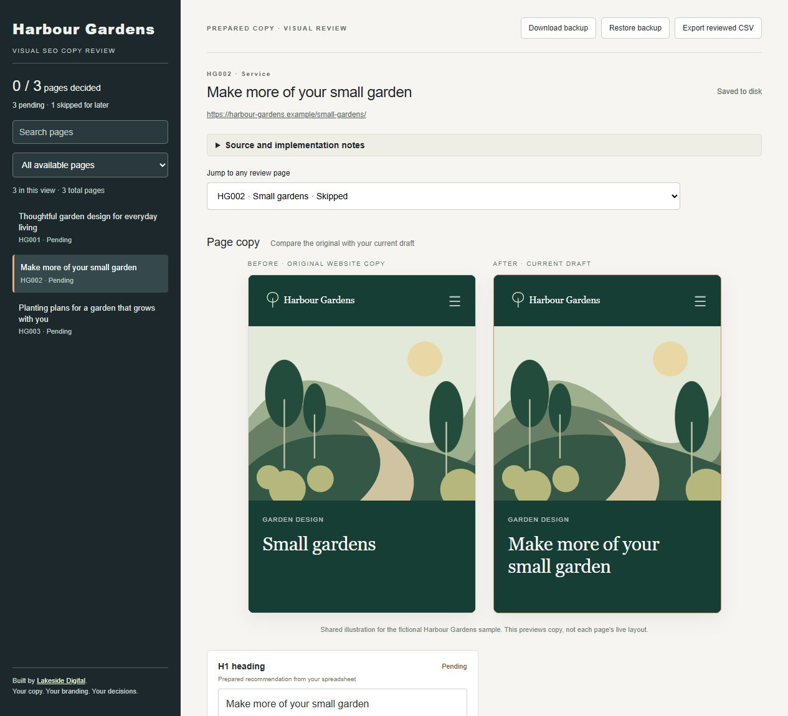

# SEO Copy Review

Turn a spreadsheet of prepared SEO recommendations into a branded visual review.

Compare existing and proposed headings, page titles and meta descriptions. Edit in context, record approvals, keep your place and export the decisions for implementation.

Built by [Lakeside Digital](https://lakesidedigital.co.nz/). The recommendations are yours: this tool does not generate copy, call an AI service or publish changes to your website.

## Try the example

1. Download this repository using **Code → Download ZIP** and extract it.
2. Install [Python 3.10 or newer](https://www.python.org/downloads/) if needed. No additional Python packages, Node, API keys or accounts are required.
3. Open a terminal in the extracted folder and run:

   ```sh
   python server.py
   ```

   On Windows, use `py server.py` if `python` is unavailable. On macOS/Linux, you may need `python3 server.py`.

4. Open **http://127.0.0.1:8780** in your browser.

The example is a fictional garden design business. Sample copy and original SVG illustrations are included; no client data is bundled. Stop the server with Ctrl+C. Run the same command to resume.



## Use your own spreadsheet

Make a separate, values-only review sheet using the column names in [example.csv](example.csv). You can supply an `.xlsx` file (the first worksheet is read) or a UTF-8 `.csv`. Formula cells are rejected so cached formula results cannot silently become your review baseline.

```sh
python server.py --input private/client-copy.xlsx --brand private/client-brand.json --data-dir private/client-review
```

Each page needs a unique `page_id`, a full `url`, and at least one original/proposed field pair:

| Original column | Proposed column | Purpose |
| --- | --- | --- |
| `original_h1` | `proposed_h1` | Main heading |
| `original_title` | `proposed_title` | Search/page title |
| `original_meta` | `proposed_meta` | Meta description |
| `original_intro` | `proposed_intro` | Existing introductory subheading, where present |
| `original_body_h2` | `proposed_body_h2` | Body heading |
| `original_body_h2_second` | `proposed_body_h2_second` | Second body heading |
| `original_secondary_h1` | `proposed_secondary_h1` | Additional captured H1 |

Optional columns: `page_type`, `rationale`, `implementation_notes`. They appear as review context. Extra columns are ignored; retain your source workbook for other research, sheets, formulas and formatting.

Omit field pairs that are outside scope. Blank/blank pairs on an individual row are absent, not invented editable components. Headings, titles and descriptions supplied for review need decisions. Other unchanged fields are optional until edited or explicitly decided; changed proposals need decisions. An introductory subheading that does not exist on the page requires a separate template decision and is not supported as a copy-only addition.

Duplicate URLs are allowed when they have different stable IDs. Do not use row numbers that change whenever you sort the sheet. The importer does not crawl pages, select keywords, infer locales or validate your recommendations.

## Apply client branding

Copy [brand.json](brand.json) to `private/client-brand.json`. Set the name, colours, font, logo filename, shared reference image filename and explanatory caption. Supported fonts are Arial, Georgia and Verdana. Use image files you are allowed to use.

Place the logo and image beside `server.py` using names such as `client-logo.png` and `client-reference.jpg`. The brand file uses those filenames without folders. PNG, JPG, WebP and SVG are supported. Leave `logo` or `image` empty to omit that asset. The remaining copy stays editable. Do not include private client assets in public commits.

The shared reference image and branding provide an illustrative layout. They do not reproduce every live template. Search previews and Arial-based width estimates are editorial aids, not guarantees of what Google will display. Widths warn by default; they do not prevent typing.

## Review and hand off

- **Accept proposed:** approve the spreadsheet recommendation. This deliberately replaces an edited draft for that field.
- **Keep original:** approve the original value, including an explicitly empty original.
- **Accept with changes:** approve your edited wording.
- **Undo decision:** return to pending and retain the draft.
- **Save choices and next:** approve manually edited pending fields, except fields explicitly left pending with Undo. Untouched fields stay pending.
- **Approve all current copy:** approve effective copy on this page, preserving edits and existing keep-original decisions.
- **Keep all original copy and next:** explicitly retain the page's original values.
- **Skip for now:** retain drafts and decisions and move on without new approvals.

Navigation and autosave alone never approve copy. The all-page dropdown contains the entire input inventory even when the sidebar is filtered. The Skipped filter can overlap Pending.

Decisions save atomically to `--data-dir/decisions.json`. **Saved to disk** appears after the server confirms the write. Download a JSON backup for portability. Restore validates the input version and keeps a pre-import backup. A stale tab cannot overwrite a newer revision.

**Export reviewed CSV** downloads a long-format implementation file: one row per supplied field, including original, proposed, edited draft, decision and approved copy. Pending fields have no approved copy. CSV opens in Excel and Google Sheets. This first public version does **not** rewrite or preserve the source XLSX workbook's sheets, formatting or formulas. Formula-like CSV values receive a leading apostrophe for spreadsheet safety; exact drafts remain in the JSON backup.

If you change the spreadsheet or branding, launch a new review using a new `--data-dir`. Input changes deliberately do not inherit approvals from a different baseline. Keep the old input and backup to resume the prior round. There is no automatic cross-version migration in this release.

## Use an agent to set it up

Give your agent [AGENT_SETUP.md](AGENT_SETUP.md), your prepared spreadsheet and permitted branding assets. The agent's job is to map your existing values and configure the interface. It should preserve your copy, scope and review decisions.

[RECREATION.md](RECREATION.md) records the visual and behavioural requirements behind the tool. Reuse the source when adapting it; a prose-only rebuild may lose the refinements.

## Local use and limits

Runs on your computer, bound to `127.0.0.1`. There are no analytics, external fonts or runtime network requests. The app does not provide remote client hosting, authentication or multi-user collaboration. For a client call, screen-share it; remote access would need a separately designed deployment. Do not expose this development server to the internet.

Reading `.xlsx` supports plain text/value cells on the first sheet. It does not interpret merged headers, formulas, embedded media or arbitrary multi-row schemas. Prepare a dedicated sheet using the documented headers. Input limit: 10,000 pages, 5,000 characters per field, 50 MB expanded XLSX. Typical review inventories are much smaller.

Run the checks with `python -m unittest -v test_review.py`.

## Share the project

For articles and resource lists, please link to [Lakeside Digital](https://lakesidedigital.co.nz/) as the creator. A dedicated guide is being prepared and will be linked here when live. Attribution links are appreciated, not required to use the tool.

Version **0.1.0** · [MIT licence](LICENSE). See [CHANGELOG.md](CHANGELOG.md).
